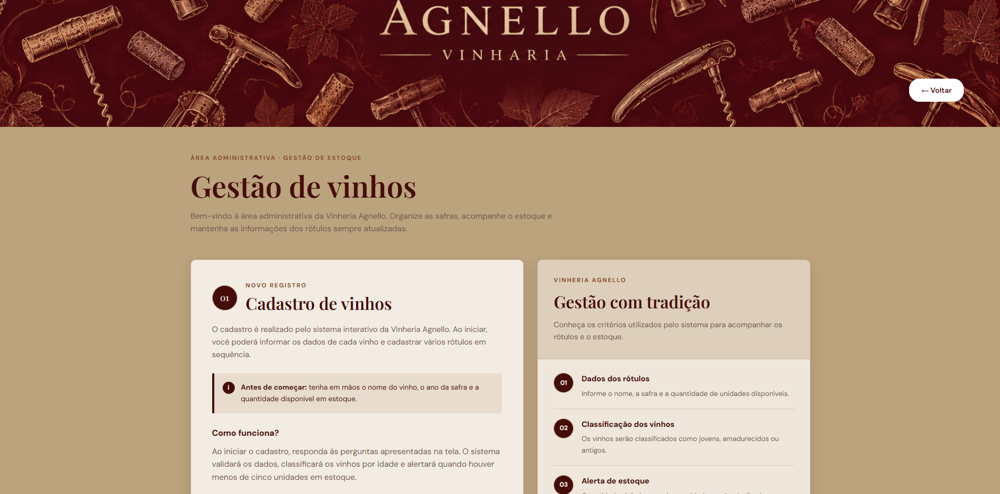
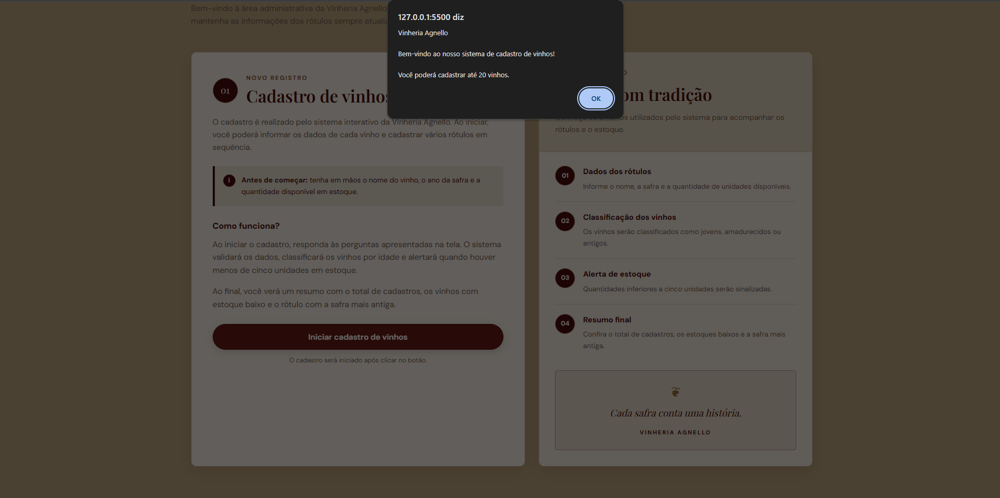

# Vinheria Agnello — Checkpoint 02

## Descrição do projeto

O projeto Vinheria Agnello foi desenvolvido como parte do Checkpoint 02 da FIAP, dando continuidade ao trabalho iniciado no CP01. A proposta é apresentar a vinheria, sua história e seus produtos por meio de um site, aproximando os clientes do universo dos vinhos e trazendo funcionalidades que também ajudam na organização do negócio.

Nesta etapa, demos um passo além na parte de programação com JavaScript. Reaproveitamos a ideia de cadastro de vinhos do CP01 e evoluímos o sistema para permitir o cadastro de vários produtos em sequência, utilizando prompt() para coletar as informações e alert() para exibir mensagens e avisos. Também criamos funções reutilizáveis para validar os dados informados, verificar se um vinho está com estoque baixo (menos de cinco unidades), classificar os vinhos como jovens, amadurecidos ou antigos e apresentar seus dados no console, com alertas para o usuário.

Ao finalizar os cadastros, o sistema apresenta um resumo com a quantidade de vinhos registrados, quantos estão com estoque baixo e qual possui a safra mais antiga. Durante o desenvolvimento, também trabalhamos com o escopo das variáveis e a reutilização de funções, evitando a repetição desnecessária de código.

Pensando em como esse recurso seria utilizado no dia a dia, criamos uma página exclusiva de administração. A ideia é que o próprio responsável pela vinheria possa acessar essa área para cadastrar novos vinhos e acompanhar informações importantes sobre os produtos e o estoque. Dessa forma, o projeto conecta os conceitos de JavaScript trabalhados na disciplina a uma situação prática de uso do site.







## Tecnologias utilizadas

- HTML5
- CSS3
- JavaScript

## Funcionalidades

- Página inicial com navegação entre as páginas do site.
- Páginas com informações sobre a vinheria e seus vinhos.
- Área administrativa para iniciar o cadastro de vinhos.
- Cadastro sequencial utilizando `prompt()` e `alert()`.
- Validação dos dados informados.
- Identificação de vinhos com estoque baixo.
- Classificação dos vinhos por idade.
- Exibição de um resumo dos cadastros realizados.

## Estrutura do projeto

```text
vinheria-agnello-checkpoint02/
│
├── index.html
├── README.md
│
└── src/
    ├── css/
    │   ├── style.css
    │   └── admin.css
    │
    ├── js/
    │   ├── script.js
    │   └── admin.js
    │
    ├── pages/
    │   ├── historia.html
    │   ├── listavinhos.html
    │   ├── experiencia.html
    │   ├── contato.html
    │   └── admin.html
    │
    └── assets/
        └── imgs/
            └── admin.png
```

## Integrantes

- Saulo Sanches Menezes
- Vitor Gimenes Vieira

## Links do projeto

- **Repositório GitHub:** https://github.com/Saulomenches/vinheria-agnello-checkpoint02)
- **GitHub Pages:** https://saulomenches.github.io/Vinharia-Agnello-CheckPoint-Front/

---

Projeto acadêmico desenvolvido para o Checkpoint 02 da FIAP.
